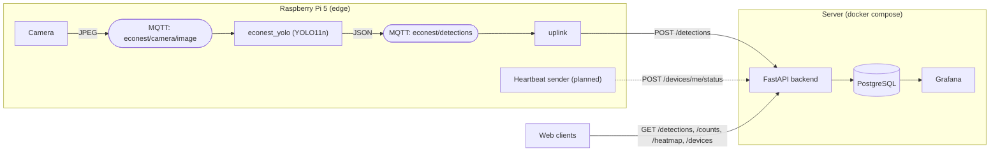

# EcoNest

### _End-to-end system solution for the Internet of Things_

Bilbao is a city with several parks and green spaces. While the infrastructural well-being of these places
is already maintained by the extensive cleaning service team of the city, it is difficult to manage the
animals that live in public spaces, which are mostly pigeons.
Since these animals can pose a threat to certain demographics, due to their ability to infect humans
with parasites or illnesses, it’s important to monitor pigeons to ensure public natural spaces are safe.
Moreover, pigeons are very efficient at finding food, which can affect the ecosystem of other animals in
parks or natural spaces. Making sure pigeon overpopulation doesn’t happen in Bilbao is key to main-
taining a healthy natural environment, which could in turn encourage people to enjoy these spaces more
than they do already.

We propose an intelligent, value-driven Internet of Things system designed to remotely monitor public
spaces with sensors and machine learning algorithms designed to identify birds, especially pigeons.
With its detection capabilities, it will be easier to locate pigeons and identify their patterns. This not only
can help city officials track their behaviour and make appropriate decisions, but also help citizens be
conscious of the behaviour of pigeons too, as we intend to make this project not only available to the city
hall, but also the general public.

[](LICENSE)
[](.github/workflows/ci.yml)
[](https://github.com/potzon/EcoNest/releases)
[](https://github.com/potzon/EcoNest/graphs/contributors)
[](https://github.com/potzon/EcoNest/issues)

[Architecture](#architecture) | [Project status](#project-status) | [Installation](#installation) | [Usage](#usage) | [Testing and CI](#testing-and-ci) | [Roadmap](#roadmap) | [Contributing](CONTRIBUTING.md) | [License](#license)

# Architecture

Each Raspberry Pi takes pictures, detects birds with a YOLO model running on the board itself, and sends only the results (class, confidence, bounding box and the picture) to a central server. The server stores them and exposes them through a REST API and Grafana.



- **MQTT stays local to the Pi.** The camera and the detector keep working without network; the `uplink` process forwards results to the backend and retries with exponential backoff while the server is unreachable.
- **Every Raspberry Pi is a registered device with its own token.** The server takes the zone and coordinates from the registered device, never from the payload, so a device cannot report detections for somewhere else.
- **The REST API is documented with OpenAPI** (interactive docs at `/docs` on the running API).

## Hardware and connections

| Component | Detail |
|---|---|
| Board | Raspberry Pi 5, 64-bit Raspberry Pi OS (inference runs on the CPU) |
| Sensor | Camera: _model and wiring still to be documented_ |
| Actuators | _None defined yet_ |

> The course brief asks the README to describe the sensors and actuators used and how they are connected. This table must be completed by whoever owns the hardware.

# Project status

| Component | State |
|---|---|
| Backend REST API (FastAPI + PostgreSQL), device tokens, size limits, CORS | Done. See [`backend/README.md`](backend/README.md) |
| Bird detection service over MQTT ([`econest_yolo`](econest_yolo/README.md)) | Done |
| Uplink to the backend (MQTT to REST, with retries) | Done |
| Grafana | Data source provisioned; **dashboards not created yet** |
| Continuous integration ([`ci.yml`](.github/workflows/ci.yml)) | Done |
| Camera capture on the Pi (publishes JPEGs to MQTT) | Pending |
| Raspberry Pi heartbeat (CPU temperature, load) | Pending: the API endpoint exists, nothing sends to it yet |
| `systemd` services for the Pi | Pending |
| HTTPS in front of the API | Pending |
| Web frontend | Not in this repository yet |

**Known limitations**

- The API is served over plain HTTP; device tokens travel unencrypted until a reverse proxy with HTTPS is added.
- All `GET` endpoints, including `/screenshots/{id}`, are public. If a camera captures people, those pictures are reachable by anyone.
- The detector only looks for birds (COCO class 14), so it cannot discard pictures in which a person appears.
- Detections waiting to be sent are kept in memory and are lost if the `uplink` process restarts.
- The Pi clock must be synchronised (NTP): the backend rejects timestamps more than 5 minutes in the future.

# Repository

```
backend/              REST API (FastAPI), database models, Grafana provisioning, docker-compose
econest_yolo/         Edge services: YOLO detector (MQTT) and uplink to the backend
scripts/              detect_file.py: run the detector on one image, no broker needed
tests/                YOLO message and uplink tests, and the YOLO-to-backend contract test
docs/                 Course brief and IoT challenge
.github/              CI workflow and the commit-check script
config.example.yaml   Template for the edge services (copy to config.yaml, which is git-ignored)
requirements.txt      Python dependencies of the edge services
```

# Installation

```bash
git clone https://github.com/potzon/EcoNest
cd EcoNest
```

Requirements: Docker with Compose (server), Python 3.10+ and an MQTT broker such as [Mosquitto](https://mosquitto.org/) (edge, on the Pi or on a laptop for development). Secrets live in a `.env` file that is git-ignored; never commit it.

# Usage

## 1. Server: API, database and Grafana

```bash
cd backend
cp .env.example .env      # fill in every value; ADMIN_TOKEN needs at least 16 characters
docker compose up --build
```

- API: <http://localhost:8000> (OpenAPI docs at `/docs`)
- Grafana: <http://localhost:3000> (user `admin`, password `GRAFANA_ADMIN_PASSWORD`)

The API refuses to start if `ADMIN_TOKEN` is missing or weak, and `docker compose` refuses to start if any secret in `.env` is empty.

## 2. Register a device (once per Raspberry Pi)

```bash
curl -X POST localhost:8000/devices \
  -H "Authorization: Bearer $ADMIN_TOKEN" -H "Content-Type: application/json" \
  -d '{"id":"nest-01","name":"Lamppost 1","zone":"Doña Casilda","lat":43.263,"lon":-2.935}'
# -> {"id":"nest-01","token":"..."}   the token is shown only once: keep it
```

## 3. Edge: detector and uplink

```bash
python3 -m venv .venv && source .venv/bin/activate
pip install -r requirements.txt
cp config.example.yaml config.yaml      # set mqtt.host, backend.url and backend.device_id
export ECONEST_DEVICE_TOKEN=<token from step 2>

python -m econest_yolo --config config.yaml            # detector: image -> detections (MQTT)
python -m econest_yolo.uplink --config config.yaml     # uplink: detections (MQTT) -> backend
```

The YOLO11n weights are downloaded on first run, or manually as described in [`econest_yolo/README.md`](econest_yolo/README.md).

## 4. Try it without a camera

```bash
python scripts/detect_file.py photo.jpg --config config.yaml   # detector only, no broker
mosquitto_pub -t econest/camera/image -f photo.jpg             # simulated camera
curl localhost:8000/detections                                 # the detection should appear here
```

## API overview

| Method | Path | Auth | Purpose |
|---|---|---|---|
| POST | `/devices` | admin | Register a device and get its token |
| POST | `/detections` | device | Send a detection (with optional screenshot) |
| POST | `/devices/me/status` | device | Heartbeat with CPU temperature, load, memory, disk |
| GET | `/devices` | public | Devices with `online`, `last_seen` and latest metrics |
| GET | `/devices/{id}/status` | public | Metrics history |
| GET | `/detections` | public | History, filterable by zone, device and time |
| GET | `/counts` | public | Pigeons per zone and hour/day |
| GET | `/heatmap` | public | Aggregated points for a heat map |
| GET | `/screenshots/{id}` | public | Picture attached to a detection |

Full details, limits and configuration variables are in [`backend/README.md`](backend/README.md).

# Testing and CI

```bash
cd backend && python -m pytest      # API tests (SQLite by default; set DATABASE_URL to use PostgreSQL)
python -m pytest tests              # YOLO messages, uplink and the YOLO-to-backend contract
```

[`ci.yml`](.github/workflows/ci.yml) runs on every push and on pull requests to `main`:

1. **Commit review**: every new commit is checked for forbidden files (`.env`, `config.yaml`, model weights, databases), files over 5 MB, `fixup!` commits, long titles and missing issue references (`Closes #NN`). It also lists commits per author. The same check can be run locally with `bash .github/scripts/check_commits.sh origin/main..HEAD`.
2. **Backend**: tests on SQLite and on PostgreSQL, validation of `docker-compose.yml` and a build of the API image.
3. **YOLO and contract**: tests of the edge services and of the message format accepted by the backend.

# Results

- **Detector.** With the frozen COCO weights, `yolo11n.pt` is reported to detect a bird in all 74 validation images of the [example pigeon dataset](https://universe.roboflow.com/wiings/pigeon-mg46t/dataset/1) (figure taken from [`econest_yolo/README.md`](econest_yolo/README.md)). The dataset is used only to test inference, not to train.
- **Integration.** The path MQTT, uplink, API and PostgreSQL has been checked locally with a Mosquitto broker and a synthetic detection message, including retries while the backend is down. The detector itself has not yet been measured end to end on the Raspberry Pi.
- _Latency, accuracy in the field and Raspberry Pi resource usage: to be measured and added here._

# References

- [Ultralytics YOLO11](https://docs.ultralytics.com/models/yolo11/) and the [COCO dataset](https://cocodataset.org/) (class 14, `bird`)
- [FastAPI](https://fastapi.tiangolo.com/), [PostgreSQL](https://www.postgresql.org/) and [Grafana](https://grafana.com/docs/grafana/latest/)
- [Eclipse Mosquitto](https://mosquitto.org/) and [paho-mqtt](https://pypi.org/project/paho-mqtt/)
- Course brief: [`docs/IoT_final_project_2026-27.pdf`](docs/IoT_final_project_2026-27.pdf)

# Sources

No third-party data sources are integrated yet. Candidates suggested in the IoT challenge are Euskalmet (weather), Open Data Euskadi (air quality) and Bilbao's open data on parks and green spaces.

# Roadmap
Long-range feature roadmap is susceptible to changes. What is planned and in progress is tracked in the open:

- **[Open issues](https://github.com/potzon/EcoNest/issues)** - Planned work, accepted feature requests, and known gaps. Issues are triaged and labelled by maintainers.
- **[Releases](https://github.com/potzon/EcoNest/releases)** - What actually shipped in each version, with notes generated from the merged pull requests on that release branch.
- **[Kanban Board](https://github.com/users/josuviteri/projects/5)** - Interactive view of current tasks, active development, and project milestones across different workflow stages.

# License
Licensed under the Apache License, Version 2.0; see [`LICENSE`](LICENSE).